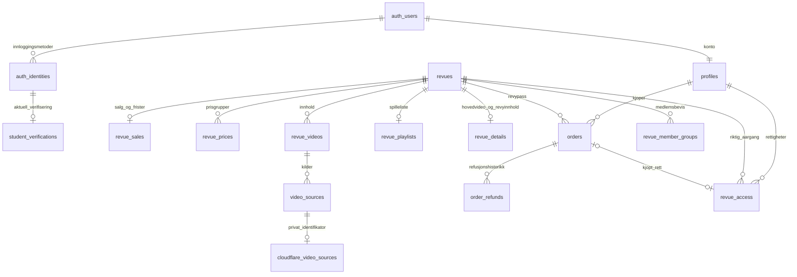

# Datamodell for verifisering, revyvideoer og revypass

Dette beskriver databaseleveransen i #144. Innlogging, LEGO-kontroll, betaling, tokenutstedelse og automatisk videosletting bygges i egne issues. En tabell eller en kontrollfunksjon er ikke en ferdig integrasjon mot leverandøren.

## Sammenhengen

## Identitet og studentpris

Supabase Auth eier identitetene. Flere innloggingsmetoder gir ikke flere profiler når de kobles riktig. Databasen implementerer ikke OAuth-callback eller sammenslåing av to eksisterende kontoer; se #123/#137/#141. Ingen Auth-providerinnstillinger endres av migrasjonene.

Signup gir ingen rabatt. Det gamle `profiles.user_type` er fjernet; profil-ID, navn og interne roller beholdes. Dagens prisgruppe kommer bare fra serververifisering med utløp.

`student_verifications` inneholder bruker, faktisk AbaID-identitet, LEGO-subject, resultat, maskinlesbar årsak, kriterieversjon, kontrolltid og utløp. Skriving er bare tillatt med service role. En trigger kontrollerer at identiteten har riktig bruker, provider `custom:abakus` og subject. Frakobling sletter det aktuelle resultatet gjennom fremmednøkkelen.

`current_price_type()` returnerer bare den innloggede brukerens effektive prisgruppe. Kontroll av utløp skjer ved oppslag; ingen cron-jobb må kjøre for at rabatten skal utløpe. Serverkode som kjører som brukeren kan bruke denne funksjonen. Service-role-kode kan lese det minimale resultatet og må gjøre samme gyldighetskontroll etter at sessionen og brukeren er verifisert.

Ingen gruppe-ID-er, faste kriterieversjoner eller standard levetid er lagt inn. Serveren må først kontrollere at personen fortsatt er student på data/cyber og oppgi avtalt utløp. LEGO-formatet alene beviser ikke fersk studieprogramtilhørighet. Negative resultater og tekniske feil skal håndteres i verifiseringsfunksjonen; en feil skal ikke forlenge et resultat. Ingen provider-tokens eller komplette medlemskapsresponser lagres.

## Videoer og kilder

`revue_videos` beskriver innhold: revy, eventuell forestilling/stream, tittel, beskrivelse, plakatsti, rekkefølge, publisering og `kind`. Mulige typer er `full`, `act_1`, `act_2`, `clip`, `trailer`, `behind_scenes` og `other`. Forestilling og stream må tilhøre samme revy; en eksplisitt forestilling på videoen må samsvare med streamens forestilling. Fremmednøkler beskytter dette også når streamen endres. Uten eksplisitt `show_id` på videoen kan forestillingen utledes gjennom streamen.

`video_sources` holder leverandør, publisering og teknisk tilstand (`processing`, `ready`, `error`, `removed`). Samme video kan ha flere kilder. En publisert metadata-rad betyr ikke at alle kildene er sluppet eller spillbare.

YouTube-ID-er ligger direkte i `video_sources.youtube_video_id`. En lenke blir offentlig først når både video og kilde er publisert, kilden er klar, og revyen er synlig og navnet avslørt. `revue_playlists` har egen publiseringstid, slik at en fremtidig spillelistelenke ikke lekker via allerede publiserte metadata. ID-er valideres; HTML/iframe-kode lagres ikke.

`cloudflare_video_sources` holder private video-ID-er. Bare admin og service role kan lese dem, og bare service role kan skrive dem. `signed_urls_verified_at` registrerer at serverintegrasjonen faktisk har kontrollert signert avspilling hos Cloudflare. Feltet slår ikke på beskyttelse hos Cloudflare. En ny/importert kilde er derfor ikke automatisk klarert for avspilling.

Byttes video-ID eller gjenopprettes en slettet provider-kilde, nullstilles både signeringsbevis og `scheduled_deletion_at`. Sistnevnte betyr faktisk bekreftet sletteplan for akkurat den eksterne ID-en. VOD krever en fremtidig bekreftet slettetid som ikke er senere enn H. Bytte av live-input nullstiller signeringsbeviset. Disse kontrollene oppretter ikke leverandørjobber; #150 må gjøre og verifisere det eksterne arbeidet.

Feltene på `revue_details` velger enten én hel forestilling eller to matchende akter, samt en valgfri fremhevet video. Referansene er bundet til samme revy. Før en valgt videos type/forestillingskobling endres må hovedvalget fjernes. Referanse-ID-er opphever aldri publikasjonspolicyene på videoene/kildene.

Redaktører redigerer innhold, YouTube-lenker og publisering og kan slette YouTube-kilder før de rydder metadata. De får ikke slette Cloudflare-kilder, skrive teknisk kildeklarering eller lese private Cloudflare-ID-er. Ingen kjøpt rett åpner redaksjonelle videoutkast.

## Ett revypass, flere forestillinger

`orders.revue_id` er kjøpsomfanget. Et gyldig pass følger alle tilgjengelige sendinger/opptak i denne revyen, også innhold som legges til senere. Det åpner ingen annen årgang og gjelder ikke fysiske billetter.

`revue_access` har ingen utløpskolonne. Kilden er enten `purchase` eller `internal`:

- En kjøpt rett krever en faktisk betalt ordre med positivt beløp, riktig bruker og samme revy. Ordre-ID er unik på rettigheten. Refusjon/tilbakekalling stopper denne retten.
- En intern rett krever serververifisert AbaID og en gruppe-ID konfigurert i `revue_member_groups` for akkurat den revyen. Minimal dokumentasjon beholdes: subject, gruppe-ID og kontrolltid. Serveren må selv ha kontrollert det faktiske medlemskapet; en matchende ID i databasen erstatter ikke LEGO-kallet.

Opptjent intern tilgang beholdes etter avsluttede studier, jobbstart, frakoblet identitet eller utmelding. Senere revyer må kjøpes med mindre personen også kvalifiserer der. Kontodeling er ikke tillatt, men datamodellen innfører ikke øktsporing, IP-binding eller DRM. Feilaktige interne tildelinger kan tilbakekalles uttrykkelig med grunn.

`can_play_source(user_id, source_id)` og `can_play_stream(user_id, stream_id)` kan bare kalles med service role. De returnerer en boolsk avgjørelse, ikke token eller kilde-ID. Edge Function må først verifisere innlogget bruker og selv velge bruker-ID. Kontrollene krever riktig revyrett, publisering, klar/signert kilde og aktiv hosting. Ingen staff-rolle gir automatisk betalt avspilling.

`has_stream_access()` er en egen chat-/metadatakontroll som tillater modereringsarbeid og revypass for publiserte streams. Det finnes ikke lenger en parallell tabell for stream-grants. Bruk aldri denne helperen som portvakt for betalt video. Realtime krever egen integrasjonstest av reconnect og tilbakekalling (#131).

## Salg, avbestilling og hosting er forskjellige klokker

`revue_sales` er påkrevd før nye ordre. Den har ett autoritativt tidspunkt for første forestilling, valgfri salgsperiode, vilkårsversjon og to hostingdatoer:

| Felt | Betydning |
| --- | --- |
| `first_show_at` | Første forestilling i hele revyen; ikke «neste stream» |
| `first_show_started_at` | Servermarkør for at første forestilling har startet; kan ikke flyttes/nullstilles |
| `stream_retire_at` | Planlagt overgang fra Stream (D) |
| `stream_delete_at` | Absolutt hosting-/slettefrist (H), fra D til maksimalt D + 30 dager |
| `terms_version` | Avtaleversjon som kopieres til nye ordre |

Nye ordre tar snapshot av revy, serverberegnet beløp/valuta, `price_type`, eventuell `eligibility_checked_at`, første forestilling, fristen to timer tidligere, vilkårsversjon og mottatt eksplisitt vilkårsaksept (`terms_accepted_at`). Snapshotet er uforanderlig. `prepare_revue_checkout()` kontrollerer åpent salg, publisert revy, rettigheter, gjeldende vilkår og verifisert prisgruppe og gjenbruker én ventende ordre per bruker/revy. Ordre-ID skal brukes som idempotensnøkkel hos betalingsleverandøren. En gammel provider-checkout må avstemmes før en ny opprettes når pris/vilkår endres. Ikke merk den utløpt bare fordi en lokal timer gikk ut. Se [backend-kontraktene](backend-contracts.md). Konto-sletting kan fortsatt nullstille ordreeieren uten å slette økonomisk historikk.

`order_cancellation_allowed(order_id)` er en service-only kontroll for **frivillig avbestilling**. Fristen er inklusive to timer før første forestilling. Et fredagskjøp etter torsdagspremiere får ingen ny frist. En avbestillingsforespørsel datostemples av databasen når serveren registrerer den; tidspunktet kan ikke etterpå skrives om. En rettidig forespørsel kan behandles etter fristen. Når vinduet er stengt kan vanlig oppdatering av salgskonfigurasjonen ikke flytte første forestilling fremover og gjenåpne det. Avlysning/flyttet premiere og lovpålagte krav krever en separat avtalt flyt.

Appens ordinære refusjonsflyt er full refusjon. `order_refunds` bevarer likevel faktiske eksterne delrefusjoner, status og referanse. Beløp kan ikke overstige kjøpet; samtidige refusjoner låser ordren ved kontroll. En vellykket avbestillingsrefusjon setter ordren til `refunded` og tilbakekaller bare den tilhørende retten. Ved en ekstern delvis avbestillingsrefusjon betyr `refunded` at kjøpet er avsluttet, ikke at hele beløpet ble tilbakebetalt; faktiske beløp ligger i ledgeren. Kompensasjon/prisavslag er et separat tilfelle og tilbakekaller ikke automatisk tilgang. En sen paid-hendelse får ikke gjenåpne en refundert ordre, og en betalt ordre kan ikke gå tilbake til ventende, feilet eller utløpt. Alle reelle belastninger skal kunne registreres, også når to checkouts likevel er betalt hos leverandøren. Refusjon av én belastning må ikke fjerne en annen gyldig rett. Vellykket refusjonshistorikk kan ikke endres eller slettes i vanlig serverflyt. Refusjon hos Stripe og webhook-/retry-behandling implementeres fortsatt i #133.

En varig rett betyr **ikke evig hosting**. Ved H stoppes ny Cloudflare-avspilling, men ordren og rettigheten beholdes. Hvis innhold senere tilbys igjen, brukes samme rett. #150 skal varsle før D/H, bytte til verifiserte YouTube-kilder, slette Stream-kopier og stoppe kostnaden. Disse migrasjonene gjør ingen av disse eksterne operasjonene. Drive-/PC-originaler er utenfor databasen og slettes ikke.

## Oppgradering og forenkling

Historiske migrasjoner er urørt. Nye migrasjoner overfører sporbare kjøpsrettigheter, priser, opptaks-ID-er, YouTube-ID-er og hovedvalg før gamle strukturer fjernes. Flere historiske kjøp fra samme bruker/revy beholdes som uavhengige ordre, uten en egen legacy-markør. Historiske snapshot-felt for prisgruppe og vilkårsaksept forblir NULL når vi ikke har faktaene.

Fjernet: `stream_prices`, `stream_access`, `youtube_video_sources`, `revue_video_selections`, `profiles.user_type`, per-stream salgs-/replayfrister, gammel opptaks-ID i `stream_playback` og streambinding på ordre. Skjemaet har 25 offentlige tabeller.

Migrasjonen stopper ved uavklarte manuelle stream-grants, priser som ikke er overført, manglende opptaks-ID-er eller flere ventende checkouts for samme bruker/revy. Slike data skal avklares, ikke slettes eller gjøres til falsk intern medlemsrett. Ingen salgsdato, gruppe eller historisk avtaleversjon finnes på som del av oppgraderingen.

`revue_sales.first_show_at` er autoritativ premiere. Den kan ikke settes senere enn en allerede registrert fysisk forestilling, og en ny tidligere forestilling krever at premiere/avbestillingsreglene oppdateres først. Når fristen er stengt, kreves fortsatt en særskilt avtalt flyt ved flytting/avlysning.

## Kontroll og gjenstående arbeid

`pnpm test:db` dekker blank database og oppgradering fra det gamle skjemaet med eksisterende profil, flere kjøp, priser og opptak. Testene bruker PGlite med minimale Auth-/Realtime-stand-ins. De er ikke en full OAuth-, provider-, Stripe- eller Cloudflare-test.

Gjenstår i egne leveranser: LEGO-kriterier/gruppe-ID-er og verifiseringslevetid; ekte linking/callback; serverautentisering og checkout-UI; leverandørkall og webhook-flyt; Stripe-godkjenning; tokenutstedelse/fornyelse; innholdsintegrasjon; varsler, Cloudflare-planlagt sletting og kontrollert faktureringsstopp. Manglende konfigurasjon skal gi avslag eller holde salg stengt, ikke åpne tilgang.

Lokal og faktisk hosted verifikasjon beskrives separat i PR-en. Genererte typer skal komme fra den migrerte databasen. Supabase MCP tildeler migrasjonsversjoner ved kjøring; de nye lokale filnavnene må samsvare med den faktiske hosted historikken før PR-en leveres.
