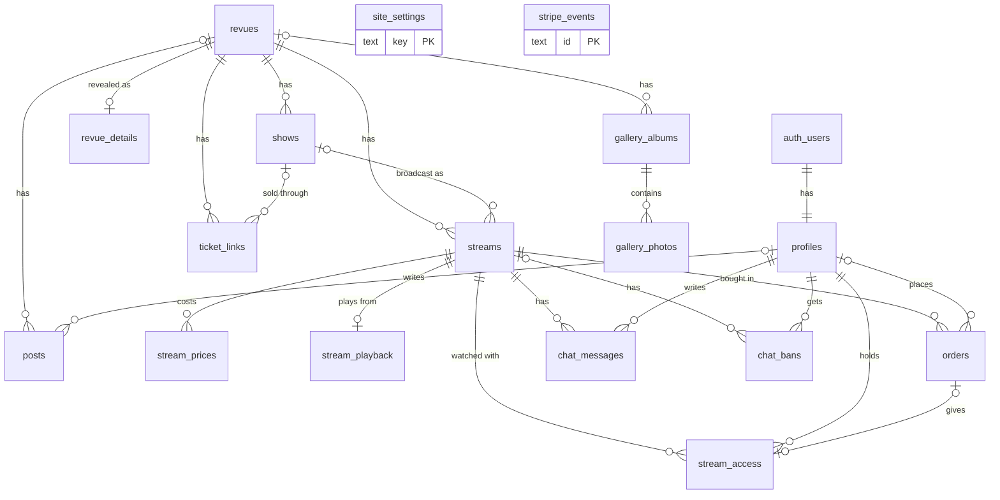

# Database

The database for the Abakusrevyen website: live streams with pay-per-stream access, stream chat, physical shows and ticket links, a photo gallery and a blog.

It runs on Supabase (Postgres 17), project `abakusrevyen.no`, ref `getffkktbyjusuyqxuzw`, region `eu-west-1`. The schema is defined by the SQL files in `supabase/migrations/`. This file explains what is there and why.

## Contents

- [Overview](#overview)
- [Ground rules](#ground-rules)
- [Users and roles](#users-and-roles)
- [Tables](#tables)
- [Who can read and write what](#who-can-read-and-write-what)
- [How things work](#how-things-work)
- [Images](#images)
- [Changing the schema](#changing-the-schema)
- [Setup still to do](#setup-still-to-do)

## Overview



17 tables in the `public` schema, grouped like this:

| Area | Tables |
|---|---|
| Users | `profiles` |
| Revue | `revues`, `revue_details`, `shows`, `ticket_links` |
| Streams | `streams`, `stream_prices`, `stream_playback` |
| Payment and access | `orders`, `stream_access`, `stripe_events` |
| Chat | `chat_messages`, `chat_bans` |
| Site | `site_settings` |
| Gallery | `gallery_albums`, `gallery_photos` |
| Blog | `posts` |

Logins live in Supabase's own `auth.users` table. Helper functions used by the access rules live in a `private` schema, which is not reachable through the API.

## Ground rules

- **Row level security is on for every table.** The browser talks to the database directly with the public key, so the database itself decides what each user may see. Hiding something in the frontend is not enough and is never relied on.
- **Rules hide rows, not columns.** Anything that must stay secret while the rest of a row is public has its own table. That is why the revue name is in `revue_details` and the Cloudflare IDs are in `stream_playback`.
- **Scheduling is done with timestamps.** In the content tables a `NULL` time means "not scheduled", which is treated as hidden. A row becomes visible when its time passes, with no job or deploy needed. `site_settings` is the one exception: there a `NULL` time means no limit.
- **Times are `timestamptz`**, stored in UTC. Convert to Norwegian time in the frontend.
- **Money is an integer in øre.** 14900 means 149 kr.
- **Payment writes come from the server.** Orders, purchased access and Stripe events are written by Edge Functions with the service role key. The browser can never create them.
- **IDs are UUIDs**, except `chat_messages.id` (a running number, so messages sort in the order they were written) and `site_settings.key`.

## Users and roles

Every login gets a row in `profiles`, created automatically at sign-up.

| `user_type` | Meaning |
|---|---|
| `student` | Signed in through Abakus OAuth |
| `external` | Everyone else, for example Vipps |

`user_type` decides which price a user pays for a stream. It is set at sign-up: a user becomes `student` if the login provider's ID contains `abakus`.

| `role` | Can do |
|---|---|
| `user` | Watch streams they have access to, chat, edit their own display name and avatar |
| `moderator` | Hide chat messages, ban users from chat, watch every stream |
| `editor` | Write revues, revue details, shows, ticket links, gallery and posts, see unpublished content, watch every stream |
| `admin` | Everything above, plus streams, prices, playback IDs, stream access, site settings, all profiles and all orders |

Users cannot change their own `user_type` or `role`. Roles are changed in the Supabase dashboard or with the service role key, not through the public API.

## Tables

Column lists show the type and what the column is for. `created_at` and `updated_at` are filled in automatically wherever they appear.

### profiles

One row per login. Private: a user reads only their own row, admins read all. This keeps real names from Vipps off the public API.

| Column | Type | Notes |
|---|---|---|
| `id` | uuid | Same as the user's ID in `auth.users` |
| `display_name` | text | 1 to 60 characters. Shown in chat. From the login provider, editable by the user |
| `avatar_url` | text | Full URL, optional |
| `user_type` | enum | `student` or `external` |
| `role` | enum | `user`, `moderator`, `editor` or `admin` |
| `created_at` | timestamptz | |
| `updated_at` | timestamptz | |

### revues

One row per year. Holds only what may be public before the name reveal.

| Column | Type | Notes |
|---|---|---|
| `id` | uuid | |
| `year` | smallint | Unique, one revue per year |
| `slug` | text | Unique, for URLs. Lowercase letters, digits and hyphens |
| `teaser` | text | Text shown before the name is revealed |
| `visible_from` | timestamptz | When the revue shows up on the site |
| `name_reveal_at` | timestamptz | When `revue_details` becomes readable |
| `is_current` | boolean | The revue the front page is about. Only one row can be true |
| `created_at` | timestamptz | |
| `updated_at` | timestamptz | |

### revue_details

The secret part of a revue. Unreadable by the public until both `revues.visible_from` and `revues.name_reveal_at` have passed.

| Column | Type | Notes |
|---|---|---|
| `revue_id` | uuid | The revue. One row per revue |
| `name` | text | The name of the revue |
| `tagline` | text | |
| `description` | text | |
| `poster_path` | text | Storage path of the poster image |
| `created_at` | timestamptz | |
| `updated_at` | timestamptz | |

### shows

A physical performance: when and where.

| Column | Type | Notes |
|---|---|---|
| `id` | uuid | |
| `revue_id` | uuid | The revue |
| `title` | text | For example "Premiere" |
| `description` | text | |
| `starts_at` | timestamptz | |
| `doors_open_at` | timestamptz | Cannot be after `starts_at` |
| `ends_at` | timestamptz | |
| `venue_name` | text | |
| `venue_address` | text | |
| `venue_map_url` | text | Link to a map |
| `is_sold_out` | boolean | Set by hand by an editor |
| `visible_from` | timestamptz | When the show shows up on the site |
| `created_at` | timestamptz | |
| `updated_at` | timestamptz | |

### ticket_links

Links to buy tickets for the physical shows, sold on another site. A link is readable only inside its window, so the time and place of a show can be public before its buy link is.

| Column | Type | Notes |
|---|---|---|
| `id` | uuid | |
| `revue_id` | uuid | The revue |
| `show_id` | uuid | The show the tickets are for. Empty means a link for the revue as a whole |
| `label` | text | Button or link text |
| `description` | text | |
| `url` | text | Must start with `http://` or `https://` |
| `visible_from` | timestamptz | When the link shows up |
| `visible_until` | timestamptz | When it disappears. Empty means no end |
| `sort_order` | integer | Lower numbers first |
| `created_at` | timestamptz | |
| `updated_at` | timestamptz | |

### streams

Public information about a stream. One stream is one showing that can be bought.

| Column | Type | Notes |
|---|---|---|
| `id` | uuid | |
| `revue_id` | uuid | The revue |
| `show_id` | uuid | The physical show this stream broadcasts, optional |
| `slug` | text | Unique, for URLs |
| `title` | text | |
| `description` | text | |
| `thumbnail_path` | text | Storage path of the thumbnail |
| `status` | enum | `scheduled`, `live`, `ended` or `cancelled` |
| `starts_at` | timestamptz | Planned start |
| `ends_at` | timestamptz | Planned end |
| `visible_from` | timestamptz | When the stream shows up on the site |
| `visible_until` | timestamptz | When it disappears. Empty means no end |
| `sales_open_at` | timestamptz | When the buy button shows up. Empty means not for sale |
| `sales_close_at` | timestamptz | When sales stop. Empty means no end |
| `replay_available_until` | timestamptz | How long the recording can be watched. Empty means no replay |
| `chat_enabled` | boolean | Switch for posting in the chat |
| `created_at` | timestamptz | |
| `updated_at` | timestamptz | |

A stream and the show it points to must belong to the same revue. The same holds for ticket links.

### stream_prices

The price of a stream for each user type, so students and external users can pay different amounts.

| Column | Type | Notes |
|---|---|---|
| `stream_id` | uuid | The stream |
| `user_type` | enum | `student` or `external`. One row per stream and user type |
| `amount` | integer | In øre. 0 means free |
| `currency` | text | Three lowercase letters, `nok` by default |
| `stripe_price_id` | text | Optional. Leave empty if the Edge Function sends the amount to Stripe directly |
| `created_at` | timestamptz | |
| `updated_at` | timestamptz | |

### stream_playback

Cloudflare Stream identifiers. Admins and the service role only. Never store the RTMPS stream key here.

| Column | Type | Notes |
|---|---|---|
| `stream_id` | uuid | The stream. One row per stream |
| `cloudflare_live_input_id` | text | Live input UID, for live playback |
| `cloudflare_video_id` | text | Video UID of the recording, for replay |
| `created_at` | timestamptz | |
| `updated_at` | timestamptz | |

### orders

One Stripe Checkout per stream purchase. Kept when a user is deleted, for bookkeeping.

| Column | Type | Notes |
|---|---|---|
| `id` | uuid | |
| `user_id` | uuid | The buyer. Emptied if the user is deleted |
| `stream_id` | uuid | The stream. A stream with orders cannot be deleted |
| `status` | enum | `pending`, `paid`, `failed`, `expired` or `refunded` |
| `amount` | integer | In øre, copied from `stream_prices` when the checkout is created |
| `currency` | text | |
| `stripe_checkout_session_id` | text | Unique |
| `stripe_payment_intent_id` | text | Unique |
| `paid_at` | timestamptz | |
| `refunded_at` | timestamptz | |
| `created_at` | timestamptz | |
| `updated_at` | timestamptz | |

A user can have only one paid order per stream.

### stream_access

Who can watch which stream. This is the single source of truth for access: the player, the chat and the stream list all ask this table.

| Column | Type | Notes |
|---|---|---|
| `id` | uuid | |
| `user_id` | uuid | The viewer |
| `stream_id` | uuid | The stream. One row per user and stream |
| `source` | enum | `purchase` (from a paid order) or `granted` (given by an admin, for example to cast) |
| `order_id` | uuid | The order, for purchases |
| `granted_by` | uuid | The admin, for grants |
| `note` | text | |
| `expires_at` | timestamptz | Empty means no expiry |
| `revoked_at` | timestamptz | Set on refund or removal. A revoked row gives no access |
| `created_at` | timestamptz | |

### stripe_events

Stripe webhook events, keyed by Stripe's event ID so a redelivered event is not handled twice. Service role only.

| Column | Type | Notes |
|---|---|---|
| `id` | text | Stripe's event ID |
| `type` | text | For example `checkout.session.completed` |
| `payload` | jsonb | The event as received |
| `received_at` | timestamptz | |
| `processed_at` | timestamptz | Empty until handled |
| `error` | text | Set if handling failed |

### chat_messages

Chat messages per stream.

| Column | Type | Notes |
|---|---|---|
| `id` | bigint | Running number |
| `stream_id` | uuid | The stream |
| `user_id` | uuid | The writer. Filled in by the database |
| `display_name` | text | Copied from the writer's profile by the database |
| `body` | text | 1 to 500 characters |
| `created_at` | timestamptz | |
| `deleted_at` | timestamptz | Set when a moderator hides the message |
| `deleted_by` | uuid | The moderator |

The browser sends only `stream_id` and `body`. Everything else is filled in by the database, so a user cannot post under another name.

### chat_bans

Users who may not post in the chat.

| Column | Type | Notes |
|---|---|---|
| `id` | uuid | |
| `user_id` | uuid | The banned user |
| `stream_id` | uuid | The stream. Empty means every stream |
| `reason` | text | |
| `banned_by` | uuid | The moderator |
| `expires_at` | timestamptz | Empty means until the row is deleted |
| `created_at` | timestamptz | |

### site_settings

Key and value pairs for everything on the site that is not covered by another table: banners, feature switches, front page texts.

| Column | Type | Notes |
|---|---|---|
| `key` | text | Lowercase letters, digits, dots and underscores, for example `hero.banner` |
| `value` | jsonb | Any JSON: a text, a number, true or false, or an object |
| `description` | text | What the setting does |
| `is_public` | boolean | False means only admins and the service role can read it |
| `visible_from` | timestamptz | Optional. Empty means no start limit |
| `visible_until` | timestamptz | Optional. Empty means no end limit |
| `created_at` | timestamptz | |
| `updated_at` | timestamptz | |

### gallery_albums

| Column | Type | Notes |
|---|---|---|
| `id` | uuid | |
| `revue_id` | uuid | The revue, optional |
| `slug` | text | Unique, for URLs |
| `title` | text | |
| `description` | text | |
| `cover_photo_id` | uuid | The photo used as cover |
| `event_date` | date | |
| `published_at` | timestamptz | When the album shows up. Empty means draft |
| `sort_order` | integer | Lower numbers first |
| `created_by` | uuid | |
| `created_at` | timestamptz | |
| `updated_at` | timestamptz | |

### gallery_photos

| Column | Type | Notes |
|---|---|---|
| `id` | uuid | |
| `album_id` | uuid | The album. Photos are deleted with their album |
| `storage_path` | text | Where the image file is. See [Images](#images) |
| `caption` | text | |
| `alt_text` | text | Description for screen readers |
| `photographer` | text | |
| `width` | integer | In pixels, so the page can reserve space before the image loads |
| `height` | integer | In pixels |
| `sort_order` | integer | Lower numbers first |
| `taken_at` | timestamptz | |
| `created_at` | timestamptz | |

### posts

Blog posts.

| Column | Type | Notes |
|---|---|---|
| `id` | uuid | |
| `slug` | text | Unique, for URLs |
| `title` | text | |
| `excerpt` | text | Short text for listings |
| `body` | text | Markdown. Images go in with normal Markdown image syntax |
| `cover_image_path` | text | Storage path of the cover image |
| `author_id` | uuid | The writer's profile |
| `author_name` | text | Byline shown on the site. Stored here because profiles are private |
| `revue_id` | uuid | The revue, optional |
| `published_at` | timestamptz | Empty means draft. A future time schedules the post |
| `created_at` | timestamptz | |
| `updated_at` | timestamptz | |

## Who can read and write what

"Public" means anyone, signed in or not. The service role (used by Edge Functions) can do everything and is left out of the table.

| Table | Read | Write |
|---|---|---|
| `profiles` | Own row. Admins: all | Own `display_name` and `avatar_url` |
| `revues` | Public once `visible_from` has passed. Editors: all | Editors |
| `revue_details` | Public once the revue is visible and `name_reveal_at` has passed. Editors: all | Editors |
| `shows` | Public once `visible_from` has passed. Editors: all | Editors |
| `ticket_links` | Public inside the visibility window. Editors: all | Editors |
| `streams` | Public inside the visibility window. Users with access and staff: also hidden ones | Admins |
| `stream_prices` | Whoever can read the stream | Admins |
| `stream_playback` | Admins | Admins |
| `orders` | Own orders. Admins: all | Service role only |
| `stream_access` | Own rows. Admins: all | Admins |
| `stripe_events` | Service role only | Service role only |
| `chat_messages` | Users with access to the stream | Insert: users who may chat. Hide: moderators |
| `chat_bans` | Own bans. Moderators: all | Moderators |
| `site_settings` | Public rows inside their window. Admins: all | Admins |
| `gallery_albums` | Public once `published_at` has passed. Editors: all | Editors |
| `gallery_photos` | Whoever can read the album | Editors |
| `posts` | Public once `published_at` has passed. Editors: all | Editors |

"Editors" and "moderators" include admins. "Staff" means any role other than `user`.

A user may chat in a stream when all of these hold: they have access to the stream, the stream has `chat_enabled`, and they have no active ban for that stream or for all streams.

## How things work

### Sign-up

1. A user signs in through Supabase Auth with Abakus OAuth or Vipps.
2. Supabase creates the row in `auth.users`.
3. A database trigger creates the `profiles` row, with the name from the login provider and `user_type` from the provider ID.

### The name reveal

1. An editor creates the revue with `visible_from` and `name_reveal_at`, and puts the name and poster in `revue_details`.
2. Until `name_reveal_at`, the API returns the revue row (year, teaser, reveal time) but no `revue_details` row. The frontend can show a countdown.
3. When the time passes, the same request starts returning the name. Nothing has to be run or deployed.

The frontend can ask for both at once: `supabase.from('revues').select('*, revue_details(*)')`. `revue_details` comes back empty before the reveal.

### Buying a stream

1. The user presses buy. The frontend calls an Edge Function.
2. The function reads the price for the user's `user_type` from `stream_prices`, creates a Stripe Checkout Session and inserts an `orders` row with status `pending`.
3. The user pays at Stripe.
4. Stripe calls the webhook function. It inserts the event in `stripe_events`. If the ID is already there, the event has been handled and is skipped.
5. The function sets the order to `paid` and inserts a `stream_access` row with source `purchase`.

On a refund the function sets the order to `refunded` and sets `revoked_at` on the access row.

### Watching a stream

1. The frontend asks an Edge Function for playback.
2. The function checks `stream_access` for the user and the stream.
3. If there is access, the function reads the Cloudflare ID from `stream_playback` and returns a signed playback token. The ID itself never reaches a user without access.

`streams` is published through Supabase Realtime (Postgres Changes), so the frontend can react when `status` changes to `live` or `ended` without polling.

### Chat

Chat uses Supabase Realtime Broadcast, sent from the database.

- **Posting:** the browser inserts `stream_id` and `body` into `chat_messages`. The database checks that the user may chat and fills in the user and name.
- **Delivery:** a trigger sends the message once to the private topic `chat:<stream id>`. Only users with access to that stream can join the topic, and browsers cannot send to it directly.
- **History:** a normal select on `chat_messages`, on load and after a reconnect. Broadcast does not replay missed messages.

Events on the topic:

| Event | When | Payload |
|---|---|---|
| `message` | A new message | `id`, `stream_id`, `user_id`, `display_name`, `body`, `created_at` |
| `message_hidden` | A moderator hides a message, or it is deleted | `id`, `stream_id` |
| `message_restored` | A hidden message is shown again | Same as `message` |

Subscribing from the frontend:

```ts
await supabase.realtime.setAuth()

supabase
  .channel(`chat:${streamId}`, { config: { private: true } })
  .on('broadcast', { event: 'message' }, ({ payload }) => addMessage(payload))
  .on('broadcast', { event: 'message_hidden' }, ({ payload }) => hideMessage(payload.id))
  .on('broadcast', { event: 'message_restored' }, ({ payload }) => addMessage(payload))
  .subscribe()
```

Two things to know:

- Access to a topic is checked when a user joins and kept for that connection. A user whose access is revoked during a stream cannot post any more, but keeps receiving messages until they reconnect.
- A hidden message stays in the table with `deleted_at` set, and its text is still returned by a select to users with access to the stream. The frontend must not show messages that have `deleted_at` set.

## Images

The database stores a path to each image, never the file. The path is the file's key in the storage bucket, for example `gallery/2027/premiere/a8f3k2.jpg`, not a full URL. The frontend puts the bucket's public address in front. That way the domain or the storage provider can change without touching the rows.

| Column | Used for |
|---|---|
| `gallery_photos.storage_path` | Gallery photos |
| `posts.cover_image_path` | Cover image of a post |
| `revue_details.poster_path` | Revue poster |
| `streams.thumbnail_path` | Stream thumbnail |
| `profiles.avatar_url` | Profile picture. The exception: a full URL, usually from the login provider |

Images inside a blog post are referenced by URL in the Markdown body.

Images are stored in Cloudflare R2, see [media-storage.md](media-storage.md). Uploads from the site will go through an Edge Function after it has checked that the user is an editor (#136). Files in a public bucket can be fetched by anyone who has the URL, even while the database hides the row, so unpublished images such as the poster before the reveal need file names that cannot be guessed.

## Changing the schema

The files in `supabase/migrations/` are the source of truth, and they match what is applied in the Supabase project:

| File | What it does |
|---|---|
| `20261006073630_initial_schema.sql` | All tables except `shows`, roles, access rules |
| `20261006080424_shows.sql` | `shows`, and the links from ticket links and streams |
| `20261006080929_chat_broadcast.sql` | Chat delivery through Broadcast |
| `20261006081003_drop_ticket_links_show_starts_at.sql` | Removes a column replaced by `shows.starts_at` |

- Change the schema by adding a new migration file, not by editing tables in the dashboard. Otherwise the files and the database drift apart.
- Do not edit a migration that has already been applied. Add a new one.
- Every new table needs row level security turned on, explicit grants and policies. The existing migrations show the pattern.
- The timestamp in each file name is the version Supabase recorded when the migration was applied.

## Setup still to do

- **First admin:** after signing in once, set the role by hand in the Supabase SQL editor: `update public.profiles set role = 'admin' where id = '<user id>';`
- **Realtime setting:** turn off "Allow public access" under Realtime Settings in the Supabase dashboard, so only private channels can be used.
- **Login providers:** set up Abakus OAuth and Vipps in Supabase Auth. The Abakus provider's ID has to contain `abakus` for users to be marked as students. If it does not, the sign-up trigger needs a new migration.
- **Image upload:** create the upload route (#136). See [Images](#images).
- **Realtime chat:** not yet tested against the real Realtime service. The database side is tested locally.
